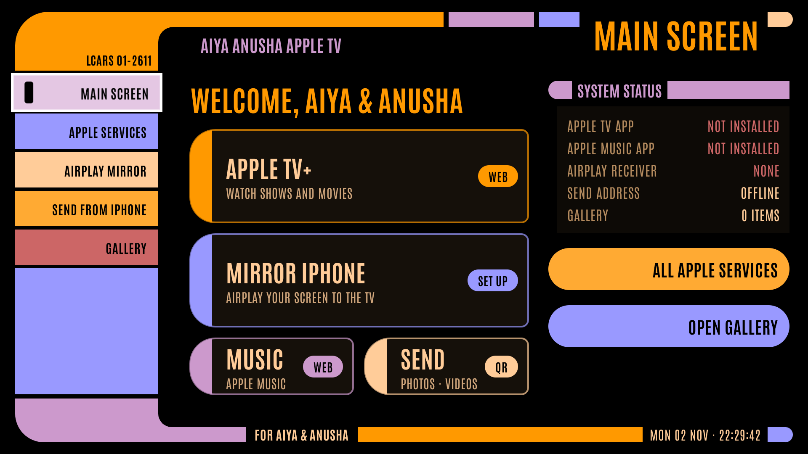

# Aiya Anusha Apple TV

An LCARS-style Android TV / Google TV app that puts Apple services on the Xiaomi TV box.
It's a personal app for sideloading, not affiliated with Apple, and not for the Play Store under this name.

| Screen | What it does |
|---|---|
| **Main screen** | Apple TV+, mirroring, Apple Music and Send, plus a status panel |
| **Apple services** | Apple TV+, Apple Music, Podcasts, iCloud Photos, Trailers. Each opens its Android app if installed, or the built-in web view if not, plus **Get app** on the Play Store |
| **AirPlay mirror** | Finds an installed AirPlay receiver (AirScreen, or any app with "AirPlay" in its name) and starts it with one press. If none is installed, opens the Play Store for one. iPhone steps are on screen |
| **Send from iPhone** | Shows a QR code. Scan it with the iPhone camera, then pick photos or videos in Safari, or paste a link. They appear on the TV right away |
| **Gallery** | Everything sent from the iPhone, with a full-screen viewer, video player, slideshow and delete |

## Mirroring
Android can't receive AirPlay on its own: Apple's protocol is closed and encrypted. This app
starts a dedicated receiver app (AirScreen is free) and walks you through it. Then, on the iPhone:
**Control Center → Screen Mirroring → pick the TV**.

## Send from iPhone
The app runs a small web server on the box (port 8765, local network only). It accepts photos,
videos and audio only, stores them inside the app, and never sends anything to the internet.

## Install
Same as last time: see [docs/INSTALL.md](docs/INSTALL.md). APK: `dist/AiyaAnushaAppleTV-debug.apk`.

## Build
JDK 17 + Android SDK 35: `./gradlew testDebugUnitTest assembleDebug`.
The Antonio font is under the SIL Open Font License (`licenses/OFL-Antonio.txt`).
